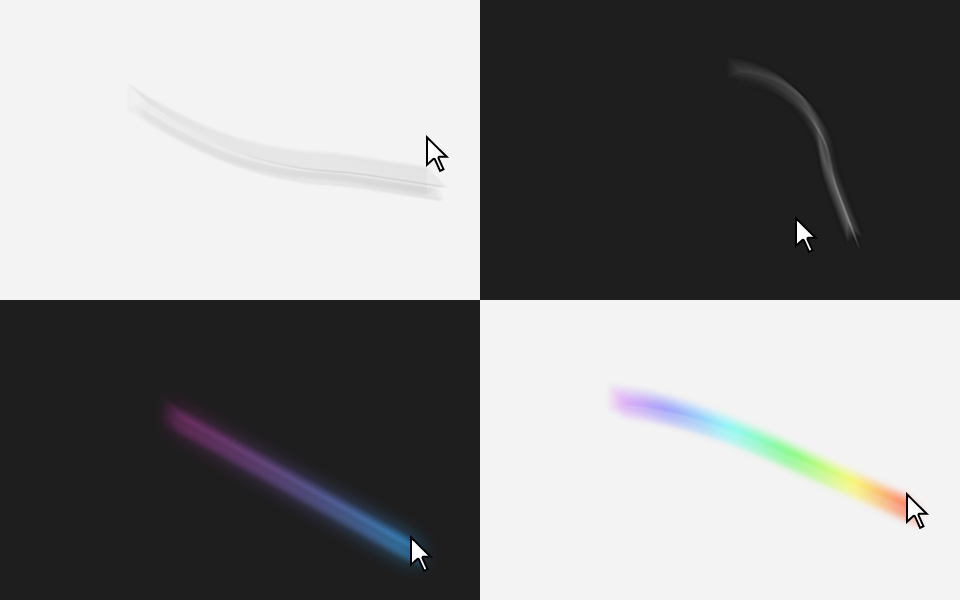

# Mouse Blur

Real motion blur for your mouse pointer, on Windows, macOS and Linux (X11).



Move the pointer quickly and a smooth smear trails behind it, the way a camera with an open shutter
records a moving object. Slow, precise movements stay sharp. The real pointer is never hidden or
replaced, so there is no added input lag, and the blur works with whatever cursor is showing:
arrow, hand, text beam or an app's own cursor.

It's a single small native binary written in Rust, with no runtime to install.

## Download

Get the latest build from the [Releases page](https://github.com/fsiuhgshiqoih32/mouse-blur/releases/latest).

| Platform | Download |
|---|---|
| Windows 10 and 11 (x64, ARM64) | `mouse-blur-<version>-windows-x64.zip` or `-windows-arm64.zip` |
| macOS 11 or later (Apple silicon and Intel) | `mouse-blur-<version>-macos.zip` |
| Linux x86_64, X11 | `mouse-blur-<version>-linux-x86_64.tar.gz` |

Unzip it and open it. The settings window appears and the effect starts. Close the window and the
effect keeps running in the system tray (menu bar on macOS); open the app again, or choose Settings
in the tray menu, to get the window back. New versions install themselves (see [Updates](#updates)).

**Windows:** the exe isn't code-signed, so SmartScreen may warn on first launch. Choose
"More info", then "Run anyway".

**macOS:** the app isn't notarized. After unzipping, run
`xattr -dr com.apple.quarantine "Mouse Blur.app"` once, or open it and then allow it under
System Settings > Privacy & Security. No permissions are needed: Mouse Blur doesn't ask for
Accessibility or Screen Recording access.

**Linux:** needs an X11 session with a compositing manager. GNOME, KDE Plasma, Xfce, Cinnamon
and MATE all composite by default on X11; on a bare window manager, run
[picom](https://github.com/yshui/picom). The tray icon needs GTK 3 and libayatana-appindicator
(`libayatana-appindicator3-1` on Debian and Ubuntu). Without them it still runs, controlled by the
hotkey and config file.

Wayland isn't supported: Wayland deliberately doesn't let apps read the pointer position over
other windows or draw above them. Under XWayland the trail only follows the pointer over X11
windows. Log in to an X11 session for full support.

## Using it

The settings window has a live preview, one-click presets (Subtle, Natural, Strong, Cinematic, Neon,
Rainbow) and every option; changes apply to the running effect immediately. The effect pauses by
itself while a fullscreen game or video is in front, and in any apps you list. **Ctrl+Alt+B** turns the effect on and off from anywhere. The tray menu has Enabled,
Settings, Start at login and Quit.

Everything is also stored in a plain config file, reloaded as soon as it's saved:

| Setting | What it does | Default |
|---|---|---|
| `intensity` | How visible the smear is, in percent. 100 is a physically accurate exposure. | 300 |
| `blur_ms` | Shutter time: how far back in time the smear reaches. | 50 |
| `taper` | How much the smear fades towards its tail, in percent. | 50 |
| `style` | `natural` (the cursor's own colours), `tint` (one colour), `gradient` or `rainbow`. | natural |
| `color` | Trail colour for the tint style, and the head colour for gradient. | `#38B6FF` |
| `color2` | Tail colour for the gradient style. | `#FF4FD8` |
| `glow` | Radius in pixels of a soft halo around the trail; 0 for none. | 0 |
| `pause_fullscreen` | Pause while a fullscreen app (a game, a video) is in front. | true |
| `excluded_apps` | Pause while one of these apps is in front, e.g. `["cs2.exe", "Photoshop"]`. | none |
| `lag_ms` | Lag compensation in ms, or `auto`. See below. | auto |
| `min_speed` | Pointer speed (px/s) below which there's no smear. | 150 |
| `hotkey` | Toggle shortcut, such as `Ctrl+Alt+B` or `Super+Shift+M`. Empty disables it. | Ctrl+Alt+B |
| `enabled` | Whether the effect is on. | true |
| `auto_update` | Install new versions automatically. | true |

The config file lives at:

- Windows: `%APPDATA%\mouse-blur\config.toml`
- macOS: `~/Library/Application Support/mouse-blur/config.toml`
- Linux: `~/.config/mouse-blur/config.toml`

**Lag compensation:** the operating system draws the real pointer a frame or two sooner than any
app can draw on screen, so the smear is pushed ahead to meet it. `auto` uses 1.5 display frames,
which is about 6 ms at 240 Hz or 25 ms at 60 Hz. If you see a gap between the pointer and the smear,
raise it. If the smear overshoots the pointer, lower it.

### Updates

Mouse Blur checks GitHub for a new release when it starts and every six hours. When there is one,
it downloads the package for your platform, checks it against the SHA-256 checksums published with
the release, replaces itself and restarts. Turn this off with "Install updates automatically" in the
settings window, which also has a Check for updates button. Copies installed somewhere you can't
write to (such as `/usr/bin`) can't update themselves.

### Command line

```
mouse-blur [--intensity <percent>] [--blur <ms>] [--taper <percent>] [--lag <ms|auto>]
           [--style natural|tint|rainbow] [--color <#RRGGBB>] [--min-speed <px/s>]
           [--hotkey <keys>] [--disabled] [--no-tray] [--config <path>]
mouse-blur --background      start only the effect, no window (what start at login uses)
mouse-blur --settings        open the settings window
```

With no options it opens the settings window. Effect options imply `--background` and override the
config file for that run. `mouse-blur --help` lists them all.

## How it works

A sampler thread reads the pointer position about 1000 times a second. Once per display refresh,
the renderer takes the path the pointer covered during the shutter window, resamples and smooths
it, and accumulates copies of the current cursor image along it, each weighted by how long the
pointer spent there. That is what a real motion blur is, so fast flicks become long faint streaks
and slower moves short dense ones. Updates from low-rate mice and touchpads are interpolated, so
they smear smoothly instead of leaving a string of separate copies.

The result goes into a click-through, always-on-top overlay:

- **Windows:** a layered window updated with `UpdateLayeredWindow` and paced with `DwmFlush`.
- **macOS:** a transparent window per screen holding a Core Animation layer.
- **Linux:** an override-redirect ARGB window with an empty input shape, with the cursor read
  through XFixes.

The overlay covers only the trail, so idle CPU use is close to zero.

## Building from source

You need Rust 1.89 or later.

```
cargo build --release
```

The binary is `target/release/mouse-blur` (`mouse-blur.exe` on Windows).

On Linux, the tray needs development headers:

```
sudo apt install libgtk-3-dev libayatana-appindicator3-dev libxdo-dev
```

Or build without the tray icon, needing nothing beyond X11 at run time:

```
cargo build --release --no-default-features
```

See [CONTRIBUTING.md](CONTRIBUTING.md) for the project layout and the tests.

## License

[MIT](LICENSE)
